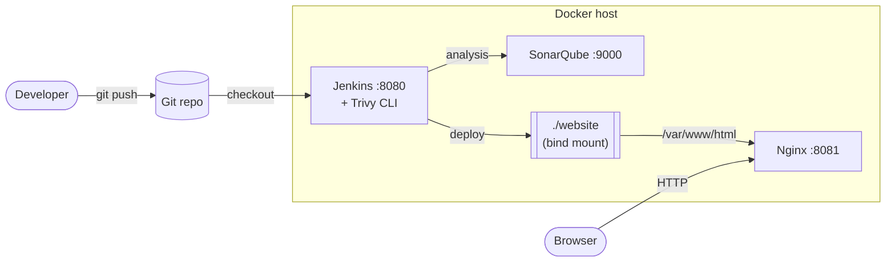
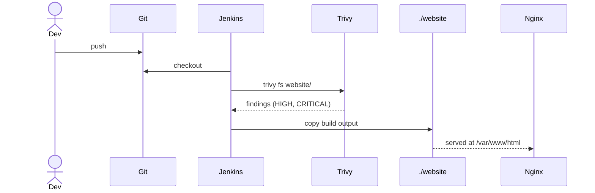
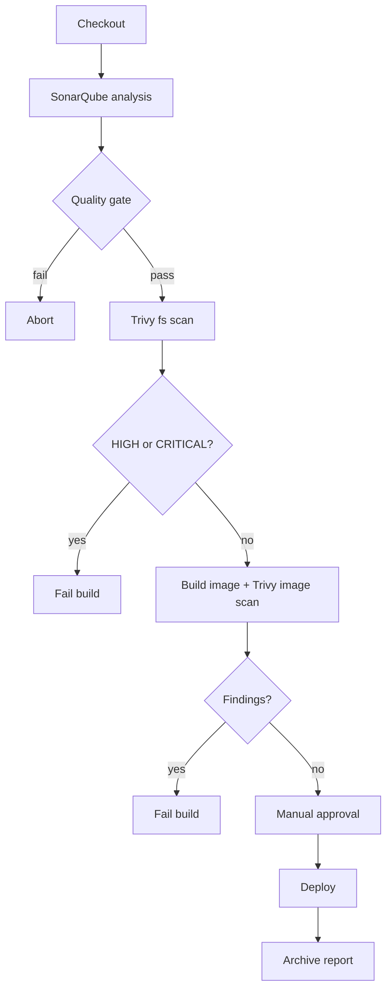

# DevSecOps CI/CD Lab: Jenkins + Trivy + SonarQube + Nginx

A self-contained CI/CD environment that builds, scans and deploys a static website. Everything runs locally with one `docker compose up`.

**Highlights**

- Infrastructure as code: the whole stack is defined in `docker-compose.yml`
- Pipeline as code: `Jenkinsfile` is versioned with the app
- Security scanning with **Trivy** (filesystem and container image)
- Code quality gates with **SonarQube**
- Zero-downtime deploys through a shared bind mount
- Three pipeline maturity levels: freestyle, basic, advanced

## Architecture



## Pipeline flow



## Advanced pipeline gates



PlantUML sources for these and more are in [docs/diagrams/](docs/diagrams/). See [Rendering PlantUML](#rendering-plantuml).

## Tech stack

| Component | Image / Tool | Port | Role |
|---|---|---|---|
| Nginx | custom, `ubuntu:24.04` | 8081 | Serves the website |
| Jenkins | `jenkins/jenkins:lts-jdk21` | 8080 | CI/CD orchestration |
| SonarQube | `sonarqube:community` | 9000 | Static analysis, quality gate |
| Trivy | CLI inside Jenkins | n/a | Vulnerability scanning |

## Repository layout

```
.
├── docker-compose.yml      # stack definition
├── Dockerfile              # nginx image
├── Jenkinsfile             # basic pipeline (pipeline as code)
├── website/index.html      # deployed application
└── docs/
    ├── 01-setup.md
    ├── 02-work-done.md
    ├── 03-freestyle-job.md
    ├── 04-basic-pipeline.md
    ├── 05-advanced-pipeline.md
    └── diagrams/*.puml     # PlantUML sources
```

## Quick start

```bash
sudo sysctl -w vm.max_map_count=262144     # required by SonarQube on Linux
docker compose up -d --build
```

Then open Nginx at http://localhost:8081, Jenkins at http://localhost:8080 and SonarQube at http://localhost:9000. Full steps are in [docs/01-setup.md](docs/01-setup.md).

## Pipeline maturity levels

| | [Freestyle](docs/03-freestyle-job.md) | [Basic](docs/04-basic-pipeline.md) | [Advanced](docs/05-advanced-pipeline.md) |
|---|---|---|---|
| Config stored in | Jenkins UI | Git | Git |
| Trivy scan | No | Report only | Fails the build |
| SonarQube quality gate | No | No | Yes |
| Image scan | No | No | Yes |
| Manual approval | No | No | Yes |

## Design decisions

- **Shared bind mount for deploys.** Jenkins and Nginx mount the same `./website` folder, so deploying is a file copy. This avoids needing the Docker socket in Jenkins just to ship static files.
- **Pinned base image** (`ubuntu:24.04`) so builds and Trivy results are reproducible.
- **Named volumes** for Jenkins and SonarQube state, so `docker compose down` doesn't lose data.
- **Scan early, deploy last.** Security and quality checks run before the deploy stage, so a failed check blocks the release.

## Known limitations and next steps

- Trivy is installed manually in the Jenkins container. A custom Jenkins image would make that permanent.
- Image scanning needs the Docker CLI and socket in Jenkins, which widens its privileges. A separate build agent would be safer.
- Add a webhook so pushes trigger builds, instead of polling.
- Add HTTPS in front of Nginx and move credentials into Jenkins credentials or a secrets manager.

## Status

The stack and the basic `Jenkinsfile` are written. The freestyle and advanced pipelines are documented but not yet created in Jenkins. See [docs/02-work-done.md](docs/02-work-done.md).

## Rendering PlantUML

GitHub renders the Mermaid diagrams above directly. The `.puml` files need PlantUML:

```bash
# CLI (needs Java and Graphviz)
plantuml -tpng docs/diagrams/*.puml

# or with Docker
docker run --rm -v "$PWD/docs/diagrams:/data" plantuml/plantuml -tpng /data
```

In VS Code, install the *PlantUML* extension and press `Alt+D` to preview.
